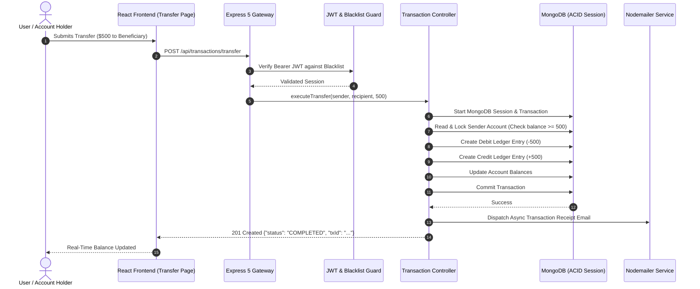

# Full Project Analysis: AegisBank

## 0.1 What the Project Is
**AegisBank** is an enterprise-grade digital banking portal and double-entry general ledger system engineered to guarantee financial mathematical consistency, prevent race-condition overdrafts, and provide instant electronic fund transfers.

Traditional naive banking apps update account balances with simple SQL/NoSQL increments (`balance = balance - amount`), which invites catastrophic race conditions, phantom withdrawals, and auditing nightmares. AegisBank solves this by enforcing strict immutable double-entry bookkeeping: every financial movement creates balanced debit and credit entries in `ledger.model.js` within an atomic transaction.

## 0.2 Financial Transaction Flow Diagram

## 0.3 Final Inventory Counts
- **Total Frontend Pages**: 5 React routes (Login/Register, Dashboard, Fund Transfer, Statement History, Beneficiaries).
- **Core Domain Routes**: 4 Express route controllers (`auth.routes`, `account.routes`, `transaction.routes`, `beneficiary.routes`).
- **Mongoose Models**: 6 schemas (`User`, `Account`, `Transaction`, `Ledger`, `Beneficiary`, `BlackList`).
- **Automated Test Suites**: 2 test suites (17 automated unit & security assertions).
