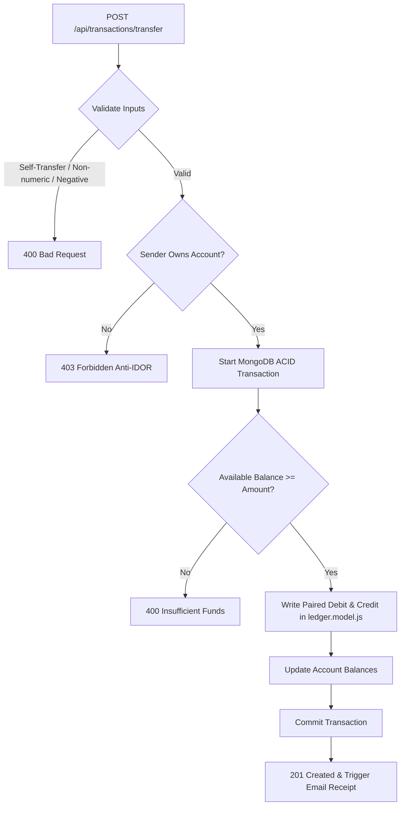

# Feature Inventory & Architectural Traces

## Core Banking Features

| ID | Feature Name | Core Implementation Files | Description |
|---|---|---|---|
| **F1** | Immutable Double-Entry Ledger Transfers | `transaction.controller.js`, `ledger.model.js` | ACID-compliant fund movements with paired debit/credit records. |
| **F2** | Token Blacklist & Secure Logout | `auth.controller.js`, `blackList.model.js` | Server-side token invalidation preventing post-logout replay. |
| **F3** | Payee Beneficiary Management | `beneficiary.controller.js`, `beneficiary.model.js` | Saved recipient directory with account validation and anti-IDOR checks. |
| **F4** | Financial Statement CSV Exporter | `transaction.controller.js:exportTransactionsCSV` | On-the-fly streaming RFC-4180 compliant CSV account statements. |
| **F5** | Real-Time React Banking Dashboard | `frontend/src/pages/Dashboard.jsx`, `api.js` | Single-page client with live balance calculation and transaction feed. |

---

## F1: Immutable Double-Entry Ledger Transfers
Executes fund transfers between accounts within an atomic MongoDB session, creating non-modifiable debit and credit records.

### Say It Out Loud
> "I built the Double-Entry Ledger transfer engine in `transaction.controller.js` to ensure financial integrity. Every transfer executes inside a MongoDB atomic session. The engine verifies that the authenticated user owns the source account, checks that the balance is sufficient, and writes a paired debit and credit record into `ledger.model.js`. Our schema strictly prohibits updates and deletes on ledger entries, guaranteeing an unalterable audit trail."

---

## F2: Token Blacklist & Secure Logout
Invalidates JWTs upon user logout by writing the token signature to a TTL-indexed MongoDB collection.

### Say It Out Loud
> "Because JWTs are stateless by design, logging out usually leaves tokens valid until expiration. In `auth.controller.js` and `blackList.model.js`, I implemented an active token blacklist. When a user logs out, their token is saved to MongoDB with a TTL index matching the token expiration time. Our auth middleware checks this blacklist before verifying signatures, instantly revoking compromised or logged-out sessions."

---

## F3: Payee Beneficiary Management
Allows users to save frequently used bank accounts with strict account number validation.

### Say It Out Loud
> "To streamline transfers, I built the Beneficiary Management feature in `beneficiary.controller.js`. Users can save verified account numbers with custom nicknames. The controller enforces 24-character hex ID validation and verifies account ownership to prevent IDOR vulnerabilities when managing payees."

---

## F4: Financial Statement CSV Exporter
Compiles transaction history into downloadable financial statements formatted for spreadsheet accounting.

### Say It Out Loud
> "For account holders needing physical records, I built the CSV export endpoint in `transaction.controller.js`. It queries the user's completed transactions, formats them with RFC-compliant headers including transaction ID, timestamp, counterparty, and amount, and streams the CSV file directly to the browser."

---

## F5: Real-Time React Banking Dashboard
Single-page interface displaying current liquidity, recent transfer activity, and quick transfer shortcuts.

### Say It Out Loud
> "On the client side, I engineered the React banking dashboard in `Dashboard.jsx`. It utilizes Axios interceptors to automatically attach JWT authorization headers and handle 401 session expirations, updating account balances and recent transfer cards dynamically without page reloads."
