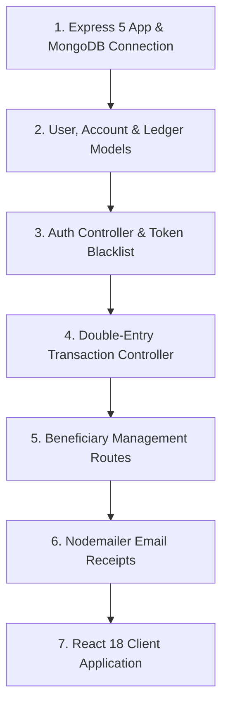

# Build Order: Reconstructing AegisBank

## Step-by-Step Implementation Sequence

1. **Bootstrap & Database**: Set up Express 5 in `server.js` and establish Mongoose connection in `src/config/db.js`.
2. **Data Modeling**: Create schemas for `User`, `Account`, `Ledger`, `Transaction`, and `Beneficiary`.
3. **Authentication & Blacklist**: Implement register, login, password change, and token blacklisting in `auth.controller.js`.
4. **Transaction Engine**: Implement atomic double-entry balance transfers in `transaction.controller.js`.
5. **Beneficiary Routes**: Mount payee management in `beneficiary.routes.js`.
6. **Email Notifications**: Connect Nodemailer transport in `email.service.js`.
7. **Frontend Client**: Initialize Vite React application with Axios interceptors and dashboard views.
